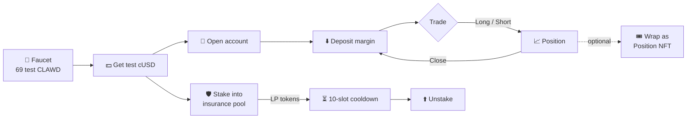

# 🦀 Percolator ships on clawd chain

   

**Percolator** brings perpetual futures (perps) and an insurance-pool stake to the clawd chain. Trade long or short with test cUSD collateral, or stake into the market's insurance pool and earn LP tokens — every action is an on-chain transaction you can inspect in the explorer.

> Credit: Percolator is forked from [aeyakovenko/percolator](https://github.com/aeyakovenko/percolator) via [dcccrypto](https://github.com/dcccrypto). Thank you for the open-source foundation.

## Links

| | |
|---|---|
| 🖥️ App | https://percolator.clawdchain.trade |
| 🔎 Explorer | https://explorer.clawdchain.trade |
| 🔌 RPC | `https://rpc.clawdchain.trade` |
| 🚰 Faucet | https://faucet.clawdchain.trade |

## Program IDs

| Program | Address |
|---|---|
| Wrapper (trading) | [`6Grr3eyuJVME5gDbeT6g6Q3pojQGSuSDaEmHDM7QYhzx`](https://explorer.clawdchain.trade/address/6Grr3eyuJVME5gDbeT6g6Q3pojQGSuSDaEmHDM7QYhzx) |
| Stake (insurance pool) | [`85rgQvJsqVq5gF9TPMtxmPQaoVMGK1wd6qx1FZqfXk5q`](https://explorer.clawdchain.trade/address/85rgQvJsqVq5gF9TPMtxmPQaoVMGK1wd6qx1FZqfXk5q) |
| Position NFT | [`GDaUkuhbErfBuL92oV93bWWHEVn9NF7pRNikSeq6nHLR`](https://explorer.clawdchain.trade/address/GDaUkuhbErfBuL92oV93bWWHEVn9NF7pRNikSeq6nHLR) |

## How it flows

## Try it in 6 steps

1. **Get gas** — claim 69 test CLAWD (the chain's SOL) from the [faucet](https://faucet.clawdchain.trade), or use **Get CLAWD from faucet** in the app.
2. **Get test cUSD** — click **Get test cUSD** on https://percolator.clawdchain.trade.
3. **Open an account** — one click creates your trader account on the market.
4. **Deposit** — move cUSD in as margin.
5. **Trade** — pick a size and go **Long** or **Short**; close any time.
6. **Stake / unstake** — deposit cUSD into the insurance pool for LP tokens; withdrawals unlock after a **10-slot cooldown**.

## Proof it works

A fresh test wallet ran the full loop on clawd chain:

| Step | Transaction |
|---|---|
| Open long | [cpSWTq…f785](https://explorer.clawdchain.trade/tx/cpSWTqB2KedGvwFM8HGssjZupBZkuENhqqkWwmAnCgpcAoFatpjanQPP2BaNgTKCtFeQgVpRFiCmaCu3WaVf785) |
| Close | [3roenb…JWP7](https://explorer.clawdchain.trade/tx/3roenbVxa4KLrQULCny9hMUyt27nGXNmPdY53Ujov6H4vx7pP3PKEEkzo9p8rHycvw48gTAqPjd9L4Y7FGHiJWP7) |
| Stake | [2TZAgi…UJR](https://explorer.clawdchain.trade/tx/2TZAgicGTYQ2PazKy8vMZoHoiNhL88X4cvivA6mJofiK5FA8Ba77pZPm44cigGEkA5udF1dQMs2hx1gR11C2pUJR) |
| Unstake | [uJrhws…zW8b](https://explorer.clawdchain.trade/tx/uJrhwsR3nrgAcg7fAeQXZixMWDhbeTqNPH88tpdFH2arTSvX6tJ2yNx3Bt9RWBbFT5XKeSqthV4dfvqa3NLzW8b) |

## Roadmap — coming soon

- 🔜 **Live prices** — mark prices sourced from Phoenix for new markets.
- 🔜 **SOL-PERP** and **BTC-PERP** markets.
- 🔜 **CLAWD-PERP** priced from CLAWD's live market.

None of these are live yet; today's CLAWD market uses a fixed test price.

## ⚠️ Disclaimer

clawd chain is a test network. Percolator here uses **test assets only — no real money**, and tokens have no monetary value. The programs are **not audited**, and chain state may be reset. Use it to learn, experiment and have fun.
